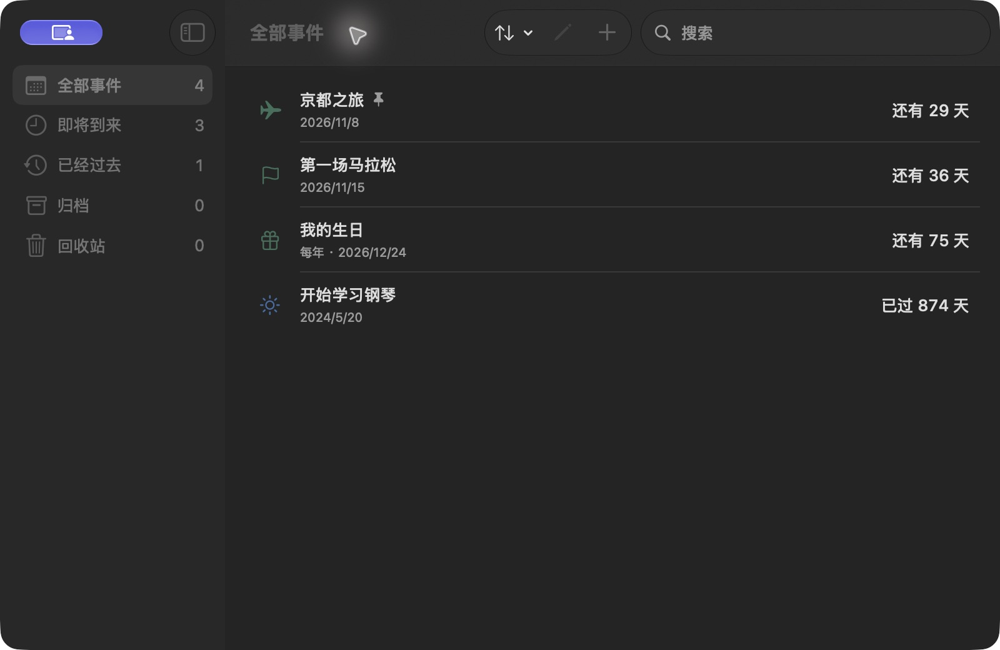
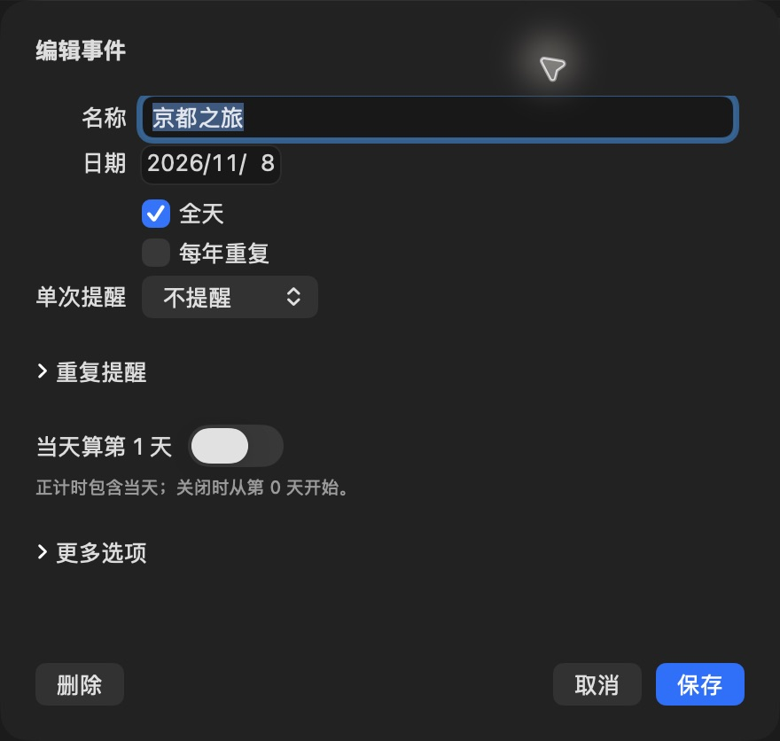
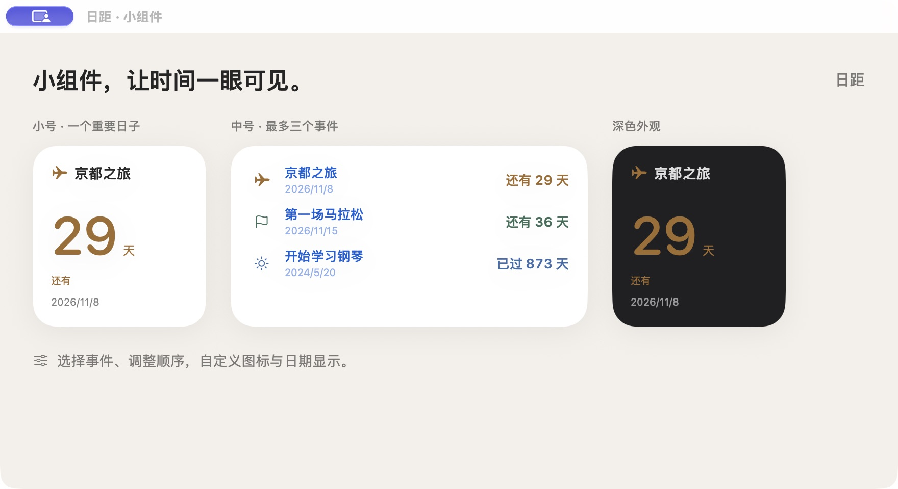
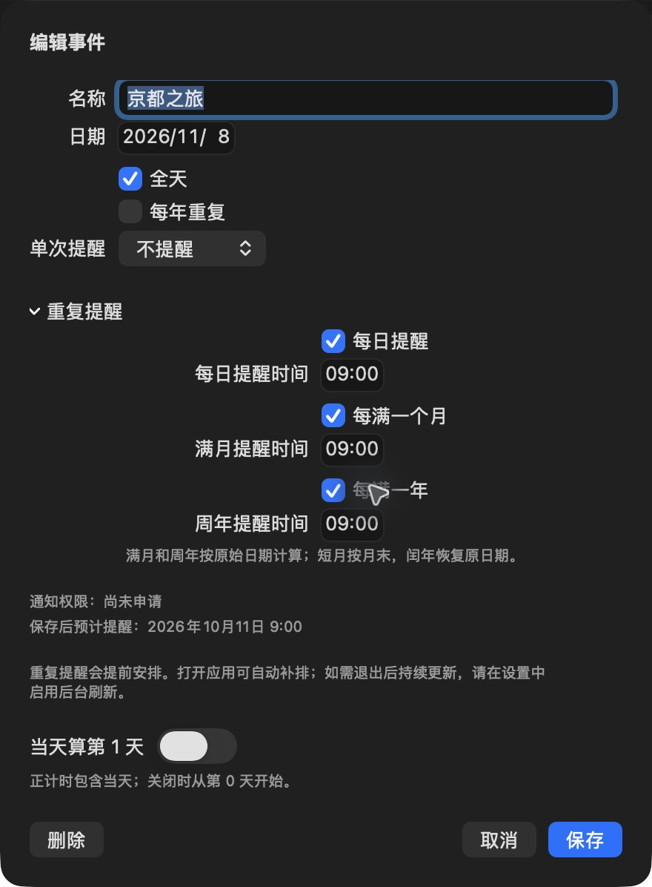

<div align="center">
  
  <h1>日距 · DayDistance</h1>
  <p><strong>让期待有日期，让回忆有刻度。</strong></p>
  <p>一款为 Mac 设计的原生倒计日应用。记录重要日子，在桌面上看见时间。</p>
  <p>
    <a href="https://github.com/liaohr9/DayDistance/releases"></a>
    
    <a href="LICENSE"></a>
    <a href="https://github.com/liaohr9/DayDistance/releases/tag/v1.18.0-preview.1"></a>
  </p>
  <p><a href="#下载">下载</a> · <a href="#一分钟开始">快速开始</a> · <a href="#桌面小组件">桌面小组件</a> · <a href="#从源码构建">源码构建</a> · <a href="docs/README.en.md">English</a></p>
</div>

<br />



> **当前发布：1.18.0（50）开发预览版。** 提供 Intel 与 Apple Silicon 通用 App ZIP（arm64 + x86_64），支持应用内检查、下载和安装更新。使用本地 ad hoc 签名，**尚无 Developer ID 签名及 Apple 公证**；从互联网下载后可能被 macOS 阻止运行。这不是已公证正式安装版。若系统阻止打开，请等待公证版本或自行从源码构建，无需关闭系统安全保护。

本次恢复 Intel 支持，主应用、小组件、CLI/MCP 和更新助手统一提供 Universal 双架构版本，保留此前性能优化与本地数据。详见[本次更新日志与验证边界](docs/RELEASE-1.18.0.md)。

## 应用语言

在“设置 → 通用 → 语言”选择 **简体中文** 或 **English**，选择后立即生效，无需重启，未保存的编辑草稿保持原样。事件名称和标签保持原文，日期与时钟保留地区格式。1.13.0 预览包已包含此功能；更早版本需手动安装一次。

## 为重要的日子，留一个位置

旅行出发还有几天、坚持一件事已经多久、下一个生日什么时候到——日距把这些信息放在一个简洁的原生窗口与桌面小组件中。

没有账号、订阅、广告或云同步。事件留在这台 Mac 上；你可以随时导出事件备份。

| 能力 | 你可以做什么 |
| :--- | :--- |
| **倒计时与正计时** | 自动显示“还有 / 已过 / 今天”；正计时可选择当天算第 0 天或第 1 天。 |
| **不同的时间表达** | 按天、周 / 天、年 / 月 / 天、周年显示；支持全天事件与年度纪念日。 |
| **桌面小组件** | 小号聚焦一个日子，中号最多三个事件，大号每页五至十个；每个组件独立筛选、排序和翻页。 |
| **提醒** | 当天、提前一天、自定义提前天数与时间；每日、每满一个月、每满一年分别设置。 |
| **轻量管理** | 标签、原生色轮自选颜色、置顶、搜索、排序、多选；批量归档、移入回收站、恢复和复制为新事件。 |
| **数据保护** | 完整 JSON 导入 / 导出、最多 20 份自动本地快照、恢复预览、撤销与重做。 |
| **原生操作** | macOS 快捷键、可选 Vim 键位、中英文、可选菜单栏入口、Dock 图标外观。 |

## 下载

[**打开 Release 下载页 →**](https://github.com/liaohr9/DayDistance/releases/tag/v1.18.0-preview.1)

| 文件 | 用途 |
| :--- | :--- |
| [DayDistance-1.18.0-macOS-universal-preview.zip](https://github.com/liaohr9/DayDistance/releases/download/v1.18.0-preview.1/DayDistance-1.18.0-macOS-universal-preview.zip) | 压缩的 App，适合手动放到 Applications。 |
| [SHA256SUMS.txt](https://github.com/liaohr9/DayDistance/releases/download/v1.18.0-preview.1/SHA256SUMS.txt) | 下载完整性校验。 |

**源码构建要求：**macOS 14 或更新系统；支持 Intel（x86_64）与 Apple Silicon（arm64）。本次包内应用、小组件和更新器均为 Universal 双架构。Intel 真机和较早 macOS 运行效果仍需独立验证。该版本在 macOS 27、Xcode 27 上构建与现场验证；较早受支持系统仍需进一步实测。桌面小组件需要 macOS 14+。

下载 ZIP，解压后将「日距.app」移到 Applications。升级前先在应用中导出事件，保存或取消当前编辑并退出旧版，保留一份应用。**预览包仍受上述签名 / 公证限制约束，DMG 包装不会消除系统拦截。**

校验文件示例：

```bash
# 在 ZIP 和 SHA256SUMS.txt 所在的下载目录执行
shasum -a 256 -c SHA256SUMS.txt
```

## 一分钟开始

1. **新建日子**：点击 `＋`，或按 `⌘N`。
2. **设定日期**：填写名称和目标日期；需要具体时刻时关闭「全天」。
3. **保存**：过去的日期显示正计时，未来的日期显示倒计时。
4. **放到桌面**：桌面右键 →「编辑小组件」→ 找到日距 → 添加小号、中号或大号。

标签在编辑表单中用逗号分隔，搜索同时匹配名称和标签。“显示 → 图标与颜色 → 自定颜色…”打开 macOS 原生色轮，也可用五种带实际色标的预设；自选颜色保存在本地，应用和组件一致显示。

双击事件可修改。选中事件后按 `⌘D`，可以复制为一个新的编辑草稿；副本默认关闭提醒，取消不会创建事件。

<details>
<summary><strong>看看编辑界面</strong></summary>
<br />

<p>事件编辑分为基本信息、提醒、显示，切换时保留同一草稿。</p>
</details>

## 日期重复（1.17）

事件编辑 → 基本信息 → 重复，直接选择“不重复 / 每天 / 每月 / 每年”。每天保留原本地时间；每月保留原日号，例如 1 月 31 日 → 2 月 28/29 日 → 3 月 31 日。当天保留本次日期，次日转向下一次；短月规则无需额外设置。通知仍在“提醒”页单独开启，重复事件不会自动移入回收站。

## 普通列表与文件夹（1.17）

在侧栏“列表”右侧点击 ＋ 创建普通列表或文件夹。一个事件归属一个普通列表，可在编辑页选择或多选后移动；文件夹可以嵌套，智能列表仍可匹配这些事件。删除分类保留事件。列表备份包含层级和归属，事件JSON导出仅包含事件内容。

## 到期后与纪念显示（1.17）

在“事件 → 显示”中选择“保留为纪念日”或“移入回收站”，并选择天数、周／天、年／月／天或周年格式。默认保留原日期继续正计时；恢复后取消自动清理。一次性全天事件保留到当天结束。App关闭时组件先隐藏过期事件，下次App/CLI打开时补移回收站；未保存编辑会延后处理。

开启当天计时的组件会将今天尚未到期的定时事件显示为“还有 HH:mm”。

## 智能列表

在侧栏“列表”旁点击 ＋，选择“智能列表”，按“字段 → 比较方式 → 值”添加规则，选择满足全部或任一条件。名称、标签、日期状态、相距天数、日期范围、置顶和每年重复都可组合；实时显示匹配数。“排序与跳过”默认收起，适合创建“工作标签、未来30天、跳过最近一项”等列表。

在小组件中选择“内容来源 → 列表”，再选列表即可复用规则。外观选标准、简洁或自定；自定展开图标、日期和精确计时。原有组件选择、手动槽位和已生效的旧筛选保留。规则丢失或不可读时显示提示，不自动替换为全部事件。

智能列表独立保存，有20份本地快照及恢复确认；损坏原文会先隔离保留，较新格式拒绝覆盖。**事件导出只包含事件，不包含列表和分类。** 智能规则、层级和归属通过列表备份保护。

## 桌面小组件



<sub>以上为生产 SwiftUI 小组件内容在原生演示窗口中的截图，使用虚构事件；用于展示布局，不是系统桌面摆放截图。事件列表与编辑截图同样只含示例数据。</sub>

**本次预览包含大号组件、筛选、标签和自选颜色。**

添加后，在小组件上右键 →「编辑小组件」：

- **小号**：选择一个具体事件；不指定时由应用规则自动选择。
- **中号**：默认显示概览。打开「中号手动选择事件」，依次填写第一、第二、第三槽位，可留空；按槽位顺序展示。
- **大号**：自动概览每页可设五至十条；事件较多时用页码两侧按钮翻页。WidgetKit 组件不支持普通列表滚动或左右滑动。相同筛选、排序与每页条数的组件同步页码；不同条件各自保存页码。
- **自动筛选**：全部／未来与今天／已过、包含全部或任一标签、排除标签、排序、优先置顶、跳过前 N 条。每个组件独立保存；先筛选 → 排序 → 跳过 → 分页。比如选择“距离最近”、关闭“优先置顶”、跳过 1 条，即从次近事件开始。中号手动槽位不受自动筛选影响。
- **外观**：标准、简洁、自定；自定展开事件图标、目标日期、当天精确计时开关。每个组件保留自己的外观。

归档或回收站中的事件不会出现在自动概览里。明确选择的事件不可用时，会显示提示，不会悄悄替换成另一个事件；恢复原事件后可继续使用。

组件刷新时间由 WidgetKit 管理。更改事件后如未更新，先打开日距核对数据，再到帮助中的「小组件检查」查看状态或请求刷新。请保留 Applications 内的一份应用，避免旧扩展与新数据混用。

## 提醒：每天看见进度，也不错过纪念日

编辑事件，切换到「提醒」页：

| 提醒方式 | 行为 |
| :--- | :--- |
| **每日** | 在选定时间提醒当天距离目标日期还有 / 已过多少天。 |
| **每满一个月** | 以事件原始日期为基准。例如 6 月 10 日开始，每月 10 日提醒满几个月。 |
| **每满一年** | 在原始日期的周年提醒满几年；从满 1 年开始。 |

三项可以独立开启、分别选择时间。月末日期在短月取该月最后一天；闰日跨年按可用日期处理，并在闰年恢复原日期。

<details>
<summary><strong>看看重复提醒设置</strong></summary>
<br />

</details>

首次保存启用了提醒的事件时才请求通知权限。允许权限后，打开日距设置会自动更新状态并补排，不必重新保存事件。设置会显示**真实待发送队列的下一条提醒**和**每日提醒已安排至的日期**。

需要应用退出后继续补排时，可手动开启「后台刷新提醒」，并按 macOS 要求批准后台项目；默认关闭。通知采用有限队列预排，后台每小时续排。睡眠、关机、专注模式、权限和系统调度可能影响实际送达；没有后台续排且长期不打开应用，超过覆盖日期后不会持续提醒。预览版的跨退出送达与不同系统后台行为仍需测试。

后台已获系统允许、实际启动回执已确认且登记恢复未报错时，主窗口不再显示有限覆盖说明；关闭后台或等待批准时仍显示。权限、排队失败和队列容量错误始终保留。每次冷启动会重建一次已启用的后台登记，覆盖同版本重新安装及版本升级；若登记恢复中断，下次启动重试。不会自动开启未启用的后台项目。

本机 ad hoc 开发构建在替换后还可能遇到 AMFI 启动签名约束拒绝，系统开关显示开启也不代表后台正常。1.8.2 源码会验证启动回执、重试并在失败时保留提示；不能保证所有未正式签名构建都能恢复后台。该现场问题尚待 Developer ID 签名后重新验收。

## 键盘与批量管理

| 常用操作 | 快捷键 |
| :--- | :--- |
| 新建 / 搜索 / 编辑 | `⌘N` / `⌘F` / `⌘E` |
| 复制为新事件 | `⌘D` |
| 多选 | `⌘` 点击 / `⇧` 点击 |
| 归档 / 恢复 | `⌘⇧A` / `⌘⇧R` |
| 撤销 / 重做 | `⌘Z` / `⌘⇧Z` |

Vim 键位默认开启，可在设置关闭。仅在事件列表中生效，文本框与弹窗继续使用原生输入：

`j / k` 上下 · `gg / G` 首尾 · `/` 搜索 · `v` 连续选择 · `Space` 切换选择 · `i` 编辑 · `o` 新建 · `dd` 移入回收站 · `u / Ctrl-r` 撤销 / 重做。

回收站不会自动清空。永久删除需要确认，历史备份中可能仍有副本；请自行管理导出文件与备份。

## 数据与隐私

- 离线运行；没有账号、遥测、广告或网络自动更新。
- 当前开发预览使用 `~/Library/Application Support/DayDistanceLocal/events.json`，主应用与小组件共享本机数据。通知内容交给本机 macOS 通知系统处理。
- 「文件 → 导出事件…」保存完整 JSON；「导入事件…」加入尚不存在的事件，同一标识内容冲突时拒绝整次合并，保留当前数据。
- 成功修改后自动保留最多 20 份可读本地快照；「文件 → 备份与恢复…」先预览变化，再确认恢复。
- 当前事件写入 **schema 9**，兼容读取 schema 1–9；分类写入 schema 2。打开旧文件不会自动改写；保存新设置后请勿用不支持新格式的旧版编辑。事件导出不包含分类归属，分类结构可使用列表备份保护。
- 正式签名版将使用 App Group 容器，通过导出 / 导入迁移，不能假定不同存储模式自动共享。

详见 [使用帮助](HELP.md) · [隐私说明](PRIVACY.md)。公开截图、Issue 或诊断报告前，请检查其中是否含有个人事件。

## 从源码构建

**工具：**完整 Xcode 26 或更新版本、Python 3、Git。Icon Composer 图标需要新版本 Xcode 编译。本次预览使用 Xcode 27；项目最低部署目标为 macOS 14，没有第三方运行时依赖。

```bash
git clone https://github.com/liaohr9/DayDistance.git
cd DayDistance

# 如果 Xcode 不在默认位置，请将 DEVELOPER_DIR 指向你的 Xcode/Contents/Developer
export DEVELOPER_DIR=/Applications/Xcode.app/Contents/Developer

# 核心测试
swift test

# 无开发者账号的本机开发构建；不自动安装或启动
bash script/build_and_run.sh --build-only
```

产物：`build.noindex/Build/Products/DebugLocal/DayDistance.app`。也可以用 Xcode 打开 `DayDistance.xcodeproj`，选择 `DayDistance` scheme 与 `DebugLocal` 配置。该配置使用本地共享路径与开发沙盒目录例外，不等同于正式发行配置。

预览包的可复现编译命令、Release 签名 / 公证门槛见 [构建与发行](docs/BUILDING.md)。已有 198 项核心测试覆盖日期、生命周期、备份、组件选择、提醒排期等，并另有原生服务与故障夹具。**测试通过不等于所有系统上的实际通知送达、小组件刷新或 VoiceOver 已完整验收。**

### 工程地图

```text
App/                 原生窗口、事件管理、通知、后台与快捷指令
Widget/              WidgetKit 扩展与 AppIntent 配置
Shared/Core/         日期规则、数据模型、存储、备份与提醒策略
Shared/Presentation/ 应用与小组件共享的展示代码
Config/              Info.plist、沙盒权限、签名与后台项目配置
Resources/           Dock 图标与资源
Design/              当前 Icon Composer 图标源文件
Tests/               核心测试与原生边界夹具
script/              构建、安装、发行检查与独立 UI 验证
```

## 项目状态与参与

当前重点是让已经实现的功能稳定、易用，再完成 Developer ID / 公证、正式共享容器和更多 macOS 版本验收。快捷指令的正式签名调用、持续后台、完整 VoiceOver 朗读也仍有待验证。不会为了发布加入账号、订阅或云端服务。

欢迎 [提交问题](https://github.com/liaohr9/DayDistance/issues) 或 PR。反馈请包含版本、macOS 版本、预期 / 实际行为、复现步骤；截图请使用示例事件或遮住私人信息。贡献前请阅读 [CONTRIBUTING](CONTRIBUTING.md)。

[更新记录](CHANGELOG.md) · [构建与发行](docs/BUILDING.md) · [截图来源](docs/VISUALS.md)

以 [MIT License](LICENSE) 开源。图标及源码随仓库提供，欢迎学习、修改与贡献。

## 1.10 源码：重新组织设置

应用设置采用一级侧栏：通用、通知与后台、数据与备份、小组件。导入、导出和恢复沿用文件菜单的同一流程，编辑期间会禁用；组件检查的详细内容按需展开。

事件编辑分为“基本信息 / 提醒 / 显示”，切页不丢草稿，取消和保存固定在底部。日期的每日/月度/年度重复与通知分别设置；计数规则提供第0天／第1天示例。

基础页优先名称与日期；标签与年度规则在“更多选项”，已有规则会自动展开。颜色合并为一个带色标的入口，并保留系统色轮。帮助按五个主题折叠，小组件检查集中到设置。列表与侧栏按日期边界刷新，只有需要精确计时的行按秒更新；提醒预览不再生成完整通知队列。

小组件配置按尺寸、自动／手动／单事件模式显示适用选项。自动概览的标签、排除与跳过规则归入“更多筛选条件”；已启用的条件始终可见。旧事件选择、显示偏好、筛选与分页规则保持。1.13.0 开发预览已包含这些功能。

## 软件更新

在“设置 → 软件更新”中启用或关闭自动检查；“日距 → 检查更新…”始终可以手动检查。启用时，应用打开期间默认每天检查 GitHub 更新源一次。发现新版后由用户决定是否下载，校验通过后在应用内安装并重新打开；编辑事件、智能列表或操作文件时会延后。更新源与 ZIP 均采用 EdDSA 签名。

更新机制从 1.13.0 开始提供。已安装的更早版本需要先手动安装一次。GitHub Release 资产与签名 appcast 必须一起发布后，线上更新才可用；未公证预览仍不等于正式签名发行版。

## Agent 自动化（1.17.0）

原生 App 内置 CLI + JSON 和 MCP stdio。默认关闭访问，可在“设置 → 自动化”分别开启读取和写入；支持创建、查询、修改、归档和恢复，保护未保存的草稿。见[双语使用与 MCP 配置说明](docs/AUTOMATION.md)。
