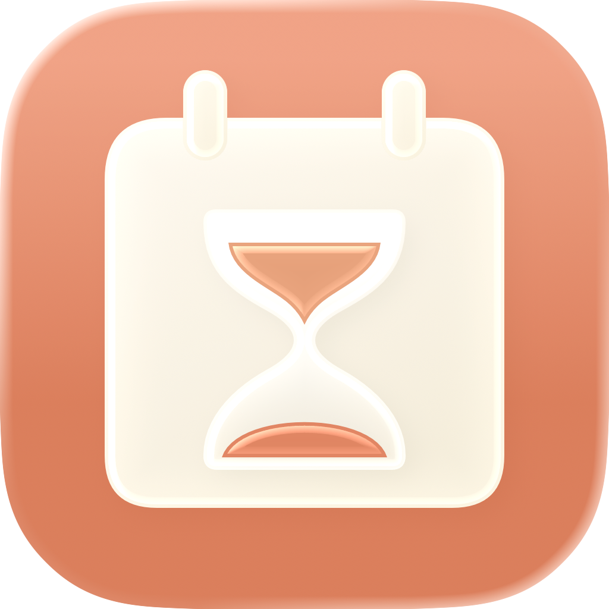
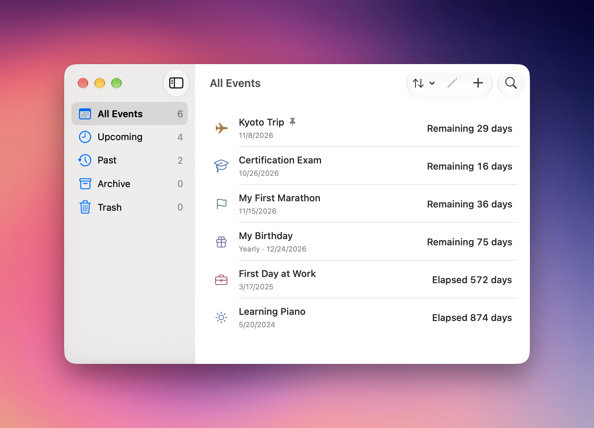
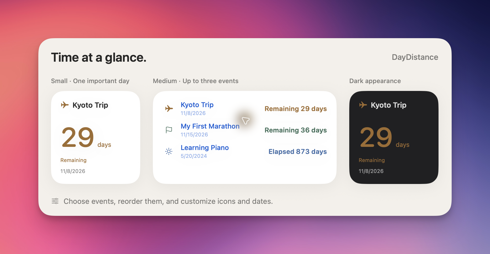

<div align="center">

<h1>DayDistance · 日距</h1>
<p><strong>Give anticipation a date. Give memories a measure.</strong></p>
<p>A native macOS day counter with desktop widgets. Local, simple, and open source.</p>
<p><a href="https://github.com/liaohr9/DayDistance/releases/tag/v1.8.1-preview.1">Download preview</a> · <a href="../README.md">中文</a> · <a href="BUILDING.md">Build guide</a></p>
</div>



> **1.8.1 is an unnotarized developer preview.** The universal DMG and App ZIP use ad hoc signing, without a Developer ID certificate or Apple notarization. macOS may block downloaded builds. This is not a notarized production release; wait for a notarized version or build from source if blocked. No system-security changes are required or recommended.

## What it does

- Counts down to future dates and counts up from past dates. Choose day zero or day one for elapsed days.
- Supports all-day events, annual anniversaries, pinning, sorting, search, and day/week/calendar/anniversary formats.
- Small widget for one event; medium widget for up to three events with manual slots. Customize icon, date, and precise-clock visibility independently.
- One-time, daily, monthly, and yearly reminders with separate times. Monthly/yearly milestones follow the original event date.
- Archive, trash, restore, duplicate, multi-select, batch actions, and undo/redo.
- Full JSON import/export and up to 20 local recovery snapshots.
- Native keyboard shortcuts, optional Vim keys and menu bar, Chinese/English, and Dock icon appearance.

No accounts, subscriptions, advertisements, telemetry, or cloud sync. Events stay on your Mac.

## Get started

1. Download the **universal preview** from [Releases](https://github.com/liaohr9/DayDistance/releases/tag/v1.8.1-preview.1). Requires macOS14+ on Apple Silicon or Intel; tested on macOS27, other supported versions still need runtime testing.
2. Move `日距.app` into Applications, subject to the preview limitations above.
3. Press `⌘N`, enter a name and date, and save. Disable All Day to specify a time.
4. Right-click the desktop, choose Edit Widgets, and add DayDistance. Edit the widget to select events and presentation.

Before upgrading, export your events, save/cancel current editing, and quit the old build. Keep only one installed app. Checksums are available as `SHA256SUMS.txt` in the Release.

## Widgets



This image uses production SwiftUI widget content with fictional events in a native showcase window. It is not a desktop placement screenshot or an integration-test claim.

The small widget uses one selected event or automatic selection. Medium widgets show an automatic overview or three manual slots in the configured order. Archived/trashed events are excluded. An unavailable explicit event shows an explanation rather than silently switching to another event.

## Reminders

Expand Recurring Reminders in the editor to enable daily, monthly, or yearly notifications. Each has its own time. A June10 event reaches a new monthly milestone on the10th and a yearly one on June10. Short months use their last available day; leap-year dates return when available.

Permission is requested only when saving an enabled reminder. Settings show current system permission, the next actually scheduled reminder, and daily coverage. Permission changes are checked automatically while Settings are visible and when reactivated.

Background renewal is optional and off by default. Enable it and approve the macOS background item if required to renew the finite queue hourly after the app quits. Sleep, shutdown, Focus, permission and OS scheduling may affect delivery. End-to-end delivery and ongoing background behavior need additional testing across supported systems.

## Keyboard and data

`⌘N` new · `⌘F` search · `⌘E` edit · `⌘D` duplicate · `⌘⇧A` archive · `⌘⇧R` restore. Use Command/Shift-click for selection and the usual Undo/Redo shortcuts.

Vim keys operate only in the list: `j/k`, `gg/G`, `/`, `v`, `Space`, `i`, `o`, `dd`, `u`, `Ctrl-r`. Text fields and dialogs retain native input.

Preview data: `~/Library/Application Support/DayDistanceLocal/events.json`. Use File → Export/Import Events for full JSON backups. Current writes use schema6; schemas1–6 can be read. Do not downgrade after saving the new format. Formal signed builds use an App Group and require export/import migration from preview data.

## Build and contribute

Full Xcode26+ (Icon Composer assets), Python3, and Git are required; this preview was built with Xcode27. There are no third-party runtime packages.

```bash
git clone https://github.com/liaohr9/DayDistance.git
cd DayDistance
export DEVELOPER_DIR=/Applications/Xcode.app/Contents/Developer
swift test
bash script/build_and_run.sh --build-only
```

Output: `build.noindex/Build/Products/DebugLocal/DayDistance.app`. See [BUILDING](BUILDING.md) for preview commands and formal-signing gates. The130 core tests do not substitute for complete widget, VoiceOver, notification-delivery or OS-compatibility acceptance.

[Contributing](../CONTRIBUTING.md) · [Changelog](../CHANGELOG.md) · [Privacy](../PRIVACY.md) · [MIT License](../LICENSE)
